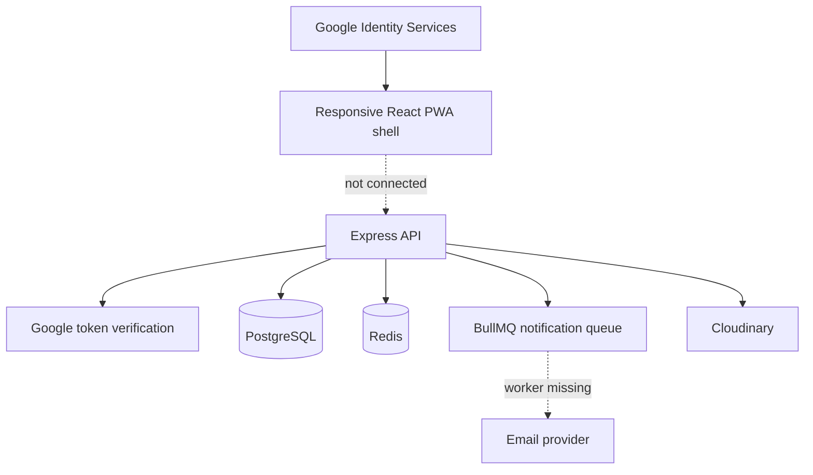

# Software Requirements Specification and RFP Conformance Audit

**Project:** MIT-WPU University Maker's Space (UMS)  
**Version:** 1.0-audit  
**Date:** 2026-08-16  
**Prepared by:** Codex  
**Client:** MIT World Peace University  
**Status:** Draft — implementation gap assessment  
**Authoritative requirement source:** `MakerSpace PRD.docx`, version 1.0

## Revision history

| Version   | Date       | Description                                                                                              |
| --------- | ---------- | -------------------------------------------------------------------------------------------------------- |
| 1.0-audit | 2026-08-16 | Cross-check of the RFP against the current frontend, backend, schema, tests, and delivery infrastructure |

## 1. Purpose and scope

This document defines the Version 1 system boundary described by the RFP and records whether the current repository satisfies it. Future-scope capabilities from RFP sections 154–184 are excluded from completion scoring, except where the repository already contains them.

Status definitions:

- **Implemented:** production-persisted behavior exists, is connected through the relevant interface, and has meaningful verification.
- **Partial:** a UI prototype, schema, isolated API, or incomplete portion exists, but the requirement is not operable end to end.
- **Missing:** no executable implementation exists for the required Version 1 behavior.

The current repository is approximately **one-third complete for RFP Version 1**. This is an engineering estimate, not an acceptance-test result. The application is **not launch-ready** because its frontend uses in-memory demo data and does not call the backend.

## 2. Product overview

UMS is intended to be the digital operating platform connecting institutional identity, student profiles, project teams, faculty verification, configurable resources, slot reservations, physical attendance, and MakerSpace operations.

### 2.1 User roles

| Role           | Required responsibility                                     | Current status                      |
| -------------- | ----------------------------------------------------------- | ----------------------------------- |
| Student        | Profile, projects, invitations, resources, bookings, visits | Partial                             |
| Faculty Mentor | Review assigned projects and approve/reject                 | Partial                             |
| Lab Assistant  | Live arrivals/exits, occupancy, no-shows, availability      | Missing operational APIs            |
| Admin          | Lab/resource/consumable configuration and oversight         | Partial schema/UI prototype         |
| Super Admin    | Privileged identity provisioning, roles, audit/governance   | Partial; backend provisioning works |

### 2.2 Technology stack

| Layer               | Current technology                                                                  |
| ------------------- | ----------------------------------------------------------------------------------- |
| Frontend            | React 19, TanStack Start/Router, TypeScript, Tailwind CSS                           |
| Backend             | Node.js, Express, TypeScript modular monolith                                       |
| Database            | PostgreSQL through Prisma                                                           |
| Cache/rate limiting | Redis/ioredis                                                                       |
| Jobs                | BullMQ queue declaration; no worker                                                 |
| Authentication      | Google Identity Services ID token verification plus application JWT/session records |
| Upload storage      | Cloudinary                                                                          |
| API documentation   | OpenAPI/Swagger                                                                     |

## 3. Architecture

The backend is structured as an appropriate modular monolith, but the dashed browser-to-API and queue-to-worker paths are currently absent.

## 4. Version 1 feature conformance

| ID           | RFP capability                            | Status                     | Evidence and remaining work                                                                                                                                                                                                                                                                              |
| ------------ | ----------------------------------------- | -------------------------- | -------------------------------------------------------------------------------------------------------------------------------------------------------------------------------------------------------------------------------------------------------------------------------------------------------- |
| SRS-FUNC-001 | Public premium landing page               | Partial                    | Responsive landing and the live institutional Google sign-in entry point exist; final content, performance, accessibility, and production-browser acceptance remain.                                                                                                                                     |
| SRS-FUNC-002 | MIT-WPU Google authentication             | Implemented core           | GIS credential exchange, login CSRF, memory-only access token, rotating HttpOnly refresh session, `/auth/me` restoration, logout, one-refresh retry coordination, and protected route guards are connected. Production OAuth/security acceptance remains.                                                |
| SRS-FUNC-003 | New-student onboarding                    | Implemented core           | The connected frontend loads active departments, department-filtered programmes and database-configured academic years, validates a 10-digit PRN, and persists the profile through the backend. Admin reference-data editing and production acceptance remain.                                           |
| SRS-FUNC-004 | Privileged account pre-provisioning       | Implemented (backend)      | Super Admin provisioning, role claim, role changes, audit, and session revocation exist. No connected UI.                                                                                                                                                                                                |
| SRS-FUNC-005 | Server-side permissions and ownership     | Implemented (backend core) | Named permissions, session checks, and scope checks exist across current routes. Missing domains have no endpoints to protect.                                                                                                                                                                           |
| SRS-FUNC-006 | Role-specific routing/navigation          | Partial                    | Authenticated routes and real account identity are connected. A clearly labelled, tab-scoped prototype switch remains intentionally available until Phase 8 to review mock role workspaces; it cannot change backend roles or permissions.                                                               |
| SRS-FUNC-007 | Student dashboard states                  | Partial                    | Dashboard identity/profile details are live, while project, approval and reservation cards still use seeded in-memory data.                                                                                                                                                                              |
| SRS-FUNC-008 | Project list and detail                   | Partial                    | Backend scoped queries and prototype screens exist; frontend is disconnected and detail responses are not consistently serialized.                                                                                                                                                                       |
| SRS-FUNC-009 | Atomic project creation/submission        | Missing                    | Project creation only creates the base project and leader. Invitations, mentor request, resource requirements, notifications, and idempotency are separate or absent.                                                                                                                                    |
| SRS-FUNC-010 | Team invitation accept/decline            | Missing                    | Backend can create an invitation token but exposes no accept/decline/cancel endpoint, no token consumer, and no idempotency test.                                                                                                                                                                        |
| SRS-FUNC-011 | Faculty search and selection              | Missing                    | No safe student-accessible paginated Faculty Mentor directory endpoint exists.                                                                                                                                                                                                                           |
| SRS-FUNC-012 | Mentor approve/reject                     | Partial                    | Backend decision and rejection reason exist; no email/in-app event generation, connected Faculty UI, or duplicate-decision concurrency test exists.                                                                                                                                                      |
| SRS-FUNC-013 | Project equipment/consumable requirements | Partial                    | Relational tables exist, but no create/update APIs connect them to project submission.                                                                                                                                                                                                                   |
| SRS-FUNC-014 | Configurable lab/schedules/closures       | Partial                    | Strong schema exists; no admin APIs or connected UI exist for schedules, closures, horizon, capacity, or cancellation policy.                                                                                                                                                                            |
| SRS-FUNC-015 | Slot generation                           | Missing                    | No schedule-generation job/service or administrative regeneration behavior exists.                                                                                                                                                                                                                       |
| SRS-FUNC-016 | Availability query and remaining capacity | Missing                    | No slots/availability endpoint exists. Frontend dates and slots are hardcoded.                                                                                                                                                                                                                           |
| SRS-FUNC-017 | Capacity-safe booking creation            | Implemented (backend)      | Serializable transaction, slot row lock, accepted-member validation, capacity recalculation, and idempotency exist.                                                                                                                                                                                      |
| SRS-FUNC-018 | Booking conflict UX and alternatives      | Partial                    | Backend returns structured conflicts; frontend demo cannot receive them and provides no alternate-slot response.                                                                                                                                                                                         |
| SRS-FUNC-019 | Student booking cancellation/history      | Implemented (backend core) | Cancellation is stateful, policy-window-aware, locked, and audited; notifications and connected history UI are absent.                                                                                                                                                                                   |
| SRS-FUNC-020 | Near-real-time availability               | Missing                    | No SSE, WebSocket, pub/sub delivery, or controlled revalidation exists.                                                                                                                                                                                                                                  |
| SRS-FUNC-021 | Quick Visit with separate capacity        | Missing                    | Schema exists, but there are no APIs, capacity transaction, or connected UI.                                                                                                                                                                                                                             |
| SRS-FUNC-022 | Student visit history                     | Missing                    | A mock screen exists; no visit read API exists.                                                                                                                                                                                                                                                          |
| SRS-FUNC-023 | Lab Assistant entry/exit                  | Missing                    | Prototype buttons mutate local arrays. No check-in/check-out API or database behavior exists.                                                                                                                                                                                                            |
| SRS-FUNC-024 | Live occupancy and no-show operations     | Missing                    | Booking status can be changed, but physical attendance, individual arrivals/exits, occupancy, late arrivals, and overstay are not implemented.                                                                                                                                                           |
| SRS-FUNC-025 | Student equipment catalogue               | Partial                    | Backend paginated catalogue exists; frontend uses a hardcoded imported catalogue and lacks server search.                                                                                                                                                                                                |
| SRS-FUNC-026 | Lab Assistant availability updates        | Partial                    | A dedicated `PATCH /equipment/:id/availability` route now requires `equipment.availability.manage`, restricts writes to status/available quantity, requires a reason, locks the equipment row, and records before/after audit metadata. A connected operations UI and near-real-time propagation remain. |
| SRS-FUNC-027 | Admin equipment management                | Partial                    | Backend CRUD and mock UI exist independently. Category management and connected uploads are missing.                                                                                                                                                                                                     |
| SRS-FUNC-028 | Consumables catalogue                     | Missing                    | Schema only; no catalogue or admin APIs.                                                                                                                                                                                                                                                                 |
| SRS-FUNC-029 | Admin lab configuration                   | Missing                    | Schema/mock local form only; no backend configuration endpoints or audit path.                                                                                                                                                                                                                           |
| SRS-FUNC-030 | Email notifications                       | Missing                    | BullMQ queue object exists, but there is no producer integration, worker, provider adapter, templates, retry telemetry, or delivery process.                                                                                                                                                             |
| SRS-FUNC-031 | In-app notifications                      | Partial                    | Basic list/create/read endpoints exist; domain workflows do not generate notifications transactionally.                                                                                                                                                                                                  |
| SRS-FUNC-032 | Scalable user/project/resource search     | Partial                    | Admin user and resource lists are paginated. Student teammate/faculty search, debounce integration, and search-specific rate limits are absent.                                                                                                                                                          |
| SRS-FUNC-033 | Initial operational reporting             | Missing                    | No booking/visit/project/equipment export or reporting API exists.                                                                                                                                                                                                                                       |
| SRS-FUNC-034 | Audit review                              | Partial                    | Audit records exist for selected actions; no `audit.read` endpoint/UI, before/after values, actor-role snapshot, or retention policy exists.                                                                                                                                                             |

## 5. External interfaces

| Interface                    | Requirement                                 | Current status                                                                      |
| ---------------------------- | ------------------------------------------- | ----------------------------------------------------------------------------------- |
| Google Identity Services     | Institutional sign-in                       | Browser handshake and backend verification connected; production acceptance pending |
| PostgreSQL                   | Authoritative transactional store           | Schema/migration validated                                                          |
| Redis                        | Shared rate limiting/cache/queue connection | Code present; no production resilience evidence                                     |
| Transactional email provider | Asynchronous messages                       | Missing                                                                             |
| Cloudinary                   | Object upload storage                       | Present, but uploads are future scope and file-type security is incomplete          |
| Real-time channel            | Availability/occupancy updates              | Missing                                                                             |

## 6. Non-functional conformance

| ID             | Requirement                               | Status                 | Finding                                                                                                                                                                               |
| -------------- | ----------------------------------------- | ---------------------- | ------------------------------------------------------------------------------------------------------------------------------------------------------------------------------------- |
| SRS-SEC-001    | Institutional OIDC verification           | Implemented in backend | Validates audience, verified email, signed hosted domain, and email suffix.                                                                                                           |
| SRS-SEC-002    | Secure sessions                           | Partial                | HttpOnly refresh cookie, rotation/reuse revocation, short memory-only access token, persisted sessions, browser restoration and logout exist; production security acceptance remains. |
| SRS-SEC-003    | Authorization on every action             | Partial                | Current APIs enforce server permissions and frontend routes enforce persisted roles; missing domains still have no endpoints to protect.                                              |
| SRS-SEC-004    | CSRF and security headers                 | Partial                | Login CSRF and Helmet/HTTPS exist; production CSP/permissions policy and full security review are not demonstrated.                                                                   |
| SRS-SEC-005    | Input/rate-limit security                 | Partial                | Zod, JSON limit, HPP, and Redis rate limiting exist; sensitive per-operation limits and upload MIME allowlists are incomplete.                                                        |
| SRS-PERF-001   | Routine API reads under 500 ms            | Unverified             | No performance or database query benchmark.                                                                                                                                           |
| SRS-PERF-002   | Booking generally under 2 seconds         | Unverified             | No representative load test.                                                                                                                                                          |
| SRS-PERF-003   | Landing LCP at or below 2.5 seconds       | Unverified             | No Lighthouse/Web Vitals test.                                                                                                                                                        |
| SRS-SCALE-001  | Horizontal stateless scaling              | Partial                | Shared DB/Redis/session design is suitable, but deployment and connection-pool strategy are undefined.                                                                                |
| SRS-SCALE-002  | Peak booking contention                   | Partial                | Correct lock design exists; mandatory concurrent integration/load test does not.                                                                                                      |
| SRS-MAINT-001  | Config instead of hardcoding              | Partial                | Database design is configurable; frontend still hardcodes people, catalogue, dates, slots, and lab values.                                                                            |
| SRS-MAINT-002  | Versioned migrations                      | Implemented            | Fresh baseline migration exists and was applied successfully to disposable PostgreSQL.                                                                                                |
| SRS-AVAIL-001  | 99.9% objective                           | Missing                | No deployment topology, SLO monitoring, redundancy, or evidence.                                                                                                                      |
| SRS-AVAIL-002  | Backups/PITR/restore                      | Missing                | No backup configuration or restore runbook.                                                                                                                                           |
| SRS-OBS-001    | Logs, metrics, traces, uptime             | Partial                | Structured logs and request IDs exist; metrics, tracing, error tracker, uptime monitor, and dashboards do not.                                                                        |
| SRS-OBS-002    | Operational alerting                      | Missing                | No alerts for auth spikes, DB, queues, latency, or service outage.                                                                                                                    |
| SRS-UI-001     | Responsive mobile/tablet/desktop          | Partial                | Responsive prototype exists, but device/browser acceptance testing is absent.                                                                                                         |
| SRS-UI-002     | WCAG 2.1 AA practical target              | Partial                | Components contain labels and focus patterns; no automated/manual accessibility audit.                                                                                                |
| SRS-UI-003     | Installable PWA                           | Partial                | Manifest and standalone mode exist; service worker, suitable icon set, installability test, and offline state are missing.                                                            |
| SRS-PERF-004   | Route splitting/minimal bundle            | Not met                | Route splitting is explicitly disabled and the current client bundle triggers the greater-than-500-kB warning.                                                                        |
| SRS-TEST-001   | Unit/integration/E2E/load/security matrix | Not met                | Four mocked/schema tests exist; no real DB API suite, booking concurrency test, E2E suite, load test, accessibility test, or security test.                                           |
| SRS-DEPLOY-001 | Dev/staging/production and CI/CD          | Missing                | No CI workflow, deployment manifests, staging environment, smoke-test job, or controlled promotion process exists.                                                                    |

## 7. Launch-readiness gate

The RFP lists 23 explicit launch conditions. None is currently proven end to end against a production-like environment. Backend Google verification, provisioning, booking capacity, and cancellation are valuable foundations, but their frontend and integration acceptance paths are incomplete.

Highest-risk blockers:

1. Authentication, onboarding, guards and live identity are connected, but project, booking and operations product data still uses React memory.
2. Invitation response and atomic project submission are absent.
3. Slots cannot be generated or queried from configuration.
4. Quick Visit and physical attendance do not have APIs.
5. Email and workflow-generated notifications are absent.
6. No booking concurrency integration/load test exists.
7. Service worker/offline/installability requirements are absent.
8. Backups, monitoring, alerts, CI/CD, staging, and security acceptance are absent.

## 8. Constraints and assumptions

- The migration is a fresh baseline and requires a dedicated data-migration plan before use with an existing populated database.
- Google Cloud OAuth configuration and MIT-WPU Workspace administration are external dependencies.
- Department, programme, equipment, consumable, and operational-policy catalogues require client-approved source data.
- The RFP states 20,000+ students while current stakeholder context states up to roughly 40,000 users; capacity planning should use the larger figure.
- Future-scope Events and general uploads already consume implementation effort while launch-critical Visits, Slots, Consumables, and Administration APIs remain absent.

## 9. Requirement traceability matrix

| RFP area                       | SRS IDs                                           | Primary current sources                                                                 |
| ------------------------------ | ------------------------------------------------- | --------------------------------------------------------------------------------------- |
| Authentication/provisioning    | SRS-FUNC-002–006, SRS-SEC-001–003                 | `backend/src/modules/auth/*`, `backend/src/modules/users/*`, `src/routes/__root.tsx`    |
| Projects/mentorship            | SRS-FUNC-008–013                                  | `backend/src/modules/projects/*`, `src/routes/projects*`, `src/routes/faculty.tsx`      |
| Slots/bookings                 | SRS-FUNC-014–020                                  | `backend/src/modules/bookings/*`, `backend/prisma/schema.prisma`, `src/routes/book.tsx` |
| Visits/operations              | SRS-FUNC-021–024                                  | Schema only plus `src/routes/visits.tsx`, `src/routes/operations.tsx` mock behavior     |
| Resources/admin                | SRS-FUNC-025–029                                  | `backend/src/modules/equipment/*`, schema, `src/routes/admin.tsx`                       |
| Notifications/search/reporting | SRS-FUNC-030–034                                  | Notification routes, queue declaration, user/equipment list services                    |
| PWA/UI/performance             | SRS-UI-001–003, SRS-PERF-003–004                  | `src/routes/*`, `public/manifest.webmanifest`, `vite.config.ts`                         |
| Operations/reliability         | SRS-SCALE-_, SRS-AVAIL-_, SRS-OBS-_, SRS-DEPLOY-_ | Backend config/middleware; deployment and monitoring assets absent                      |

## 10. Recommended delivery sequence

1. Completed in Phase 1: connect Google GIS, CSRF, access/refresh session handling, `/auth/me`, logout, onboarding reference data, and role route guards.
2. Continue replacing the in-memory frontend provider per vertical workflow using the shared API/query foundation.
3. Complete the atomic project workflow, invitation responses, safe user/faculty search, requirements, and notifications.
4. Build lab configuration, closure, slot generation, and availability APIs.
5. Add real-DB booking concurrency tests, then connect booking and cancellation UI.
6. Build Quick Visit, attendance, occupancy, no-show, late-arrival, and Lab Assistant operations.
7. Complete equipment availability separation, categories, consumables, and Admin configuration.
8. Implement email worker and event-driven in-app notifications.
9. Add service worker/offline UX, route splitting, accessibility/performance verification.
10. Establish CI/CD, staging, backups/restore, monitoring/alerts, security testing, and launch acceptance.

---

Generated through the Code Analyst workflow. Requirements marked Partial or Missing require implementation and acceptance evidence before RFP sign-off.
